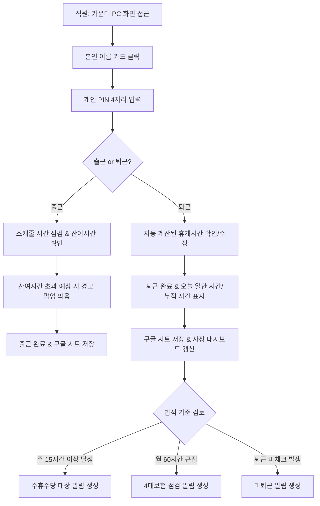
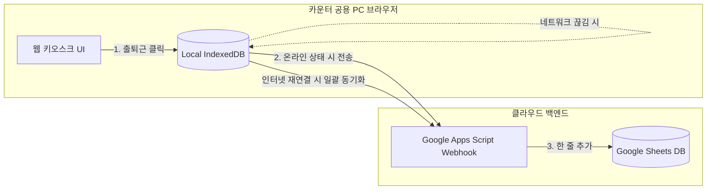

# [PRD] 카페 직원 출퇴근 기록 및 인건비 자동 계산 시스템 (Attendance Tracker)
> **문서 버전**: v1.0 (1단계 MVP 및 2단계 확장 대비 설계)  
> **대상 사용자**: 5인 미만 개인카페 사장님 및 파트타임/풀타임 직원  
> **환경**: 매장 카운터 공용 PC 1대 (웹 브라우저 기반) + 사장 개인 스마트폰(구글 시트 뷰어)  
> **데이터베이스**: Google 스프레드시트 (비공개 운영) + 브라우저 로컬 저장소(오프라인 대응)

---

## 1. 프로젝트 개요

### 1.1 배경 및 목적
* **현황**: 직원 3~4명의 다양한 근무형태(초단시간, 파트타이머, 주말, 풀타임)를 수기나 카톡으로 관리하여 월말 정산에 많은 시간이 소요되고 계산 실수 및 기록 누락 위험이 큼.
* **목적**: 
  1. 카운터 공용 PC에서 직원이 **"이름 선택 + 4자리 PIN + 버튼 1회"**로 3초 만에 출퇴근 체크.
  2. 출퇴근 기록, 근무시간, 주휴수당 대상 여부가 **구글 시트에 실시간 자동 동기화**되어 사장이 모바일에서도 즉시 확인.
  3. 직원별 근무형태(주 15시간 미만, 월 60시간 등) 기준시간 대비 **"이번 주/이번 달 남은 근무 가능 시간"**을 실시간 파악하여 법 위반 및 인건비 초과를 사전 차단.
  4. 근로기준법상 핵심 리스크(휴게시간, 주휴수당, 최저임금, 18세 미만 야간근무 등)를 **법령 조항 링크와 함께 사전 알림**.
  5. 2단계(연차 관리 및 미사용수당 정산)가 자연스럽게 붙을 수 있는 유연한 데이터 구조 구축.

### 1.2 핵심 정책 확정사항 (운영 인터뷰 결과)
1. **휴게시간**: 법정 기준(4시간당 30분) 자동 제안 + 퇴근 시 직원이 실제 쉰 시간(분) 직접 수정 가능.
2. **조기 출근 / 지연 퇴근**: **스케줄 정시 보정 원칙** (예정 시각부터 인정, 조기 출근 및 연장 근무는 사장 관리자 승인 시에만 급여에 가산).
3. **주휴수당**: 조건(주 15시간 이상) 달성 시 **대시보드 알림 및 예상액 계산** $\rightarrow$ 사장이 개근 확인 후 승인 체크 시 월급여에 자동 합산.
4. **정보 접근 권한(보안)**:
   * **직원 출퇴근 화면**: 본인의 실근무시간, 주간/월간 누적시간, 기준 잔여시간만 노출 (시급 및 급여 금액 노출 차단).
   * **사장 관리자 화면**: 시급, 일급, 총 급여, 법적 알림, 정보 수정 등 전체 권한 (관리자 마스터 비밀번호 보호).
5. **급여 산정 기간**: **매월 1일 ~ 말일** 기준.

---

## 2. 사용자 페르소나 및 핵심 사용자 흐름

### 2.1 페르소나
* **직원 A (초단시간 파트너)**: 주 15시간 미만 근무. 카운터가 혼잡할 때 빠르게 출퇴근을 찍고, 이번 주에 본인이 몇 시간 더 일할 수 있는지 직관적으로 확인하고 싶음.
* **직원 B (주 25시간 파트타이머)**: 계약된 주 소정근로시간을 준수하고, 본인의 일한 시간이 누락 없이 정확히 기록되길 원함.
* **사장님**: 개발 지식 없음. 법 위반 걱정 없이 매장을 운영하고 싶고, 월말마다 계산기 두드리는 반복 업무에서 해방되고 싶음.

### 2.2 핵심 플로우


---

## 3. 화면별 상세 기능 요구사항 (UI/UX)

시스템은 단일 웹 애플리케이션(SPA)으로 동작하며, 크게 **[직원용 키오스크 뷰]**와 **[사장 관리자 뷰]**로 분리됩니다.

### 3.1 [화면 1] 공용 출퇴근 키오스크 화면 (직원용)
* **목적**: 바쁜 카운터 환경에서 3초 이내에 직관적이고 안전하게 출퇴근 기록.
* **UI 구성**:
  * **상단 바**: 현재 날짜 및 실시간 디지털 시계, 네트워크 연결 상태 표시등(초록: 정상, 주황: 오프라인 임시저장 중), 사장 모드 전환 버튼.
  * **직원 그리드 카드**: 등록된 직원 이름이 큰 타일 카드 형태로 표시 (프로필 색상 또는 이니셜).
  * **PIN 입력 모달**: 직원 카드 클릭 시 팝업되는 간편 숫자 키패드 (4자리 마스킹 `****`).
  * **출퇴근 메인 모달**:
    * 출근 전: 
      * **기본 출근**: 오늘 계획된 정규 스케줄 시각(예: `13:00`)이 기본값으로 자동 표시되며, **`[계획대로 출근 (13:00)]`** 원클릭 버튼 제공.
      * **직접 입력(조기 출근 등)**: 일찍 출근하여 즉시 업무를 시작해야 하는 경우, **`[출근시간 직접 변경]`** 버튼을 눌러 실제 업무 시작 시각(예: `12:30`)을 직원이 직접 입력 후 출근 가능.
    * 근무 중: [퇴근하기] 큰 버튼, 현재까지 일한 시간 실시간 타이머.
    * **근무 시간 요약 박스 (금액 노출 금지)**:
      * `오늘 일한 시간`: 0시간 00분
      * `이번 주 누적 시간`: 11시간 20분 / 기준 15시간 미만 (**남은 시간: 3시간 40분**)
      * `이번 달 누적 시간`: 48시간 10분 / 기준 60시간 미만 (**남은 시간: 11시간 50분**)
  * **퇴근 확인 팝업**:
    * "오늘 휴게시간은 기본 30분으로 계산되었습니다. 변경하시겠습니까?"
    * `[-] [30분] [+]` 또는 직접 분 입력 인풋 제공.
* **인터랙션 및 예외 처리**:
  * PIN 5회 오류 시 1분간 잠금.
  * 파트너가 계획보다 일찍 직접 시간을 입력한 경우: 사장 관리자 대시보드에 **`[조기 출근 직접 입력]`** 알림 및 확인 플래그 자동 전송.
  * 오늘 예정 근무시간이 주간/월간 남은 시간보다 길 경우:  
    `⚠️ [주의] 오늘 예정 근무(5시간)를 진행하면 이번 주 기준시간(15시간)을 1시간 20분 초과합니다. 사장님께 확인 후 출근하세요.` (확인 누르면 출근은 가능하되 기록에 초과 플래그 기록).

### 3.2 [화면 2] 사장 전용 관리자 대시보드
* **접근**: 관리자 마스터 비밀번호 입력 시 진입.
* **컴포넌트 1: 오늘 매장 현황판**:
  * 현재 출근 중인 직원 목록 및 실시간 근무시간.
  * 미퇴근 의심 직원 표시 (예정 퇴근시간 1시간 경과 후에도 퇴근 미체크 시 빨간색 뱃지).
* **컴포넌트 2: 법적 리스크 & 알림 센터 (Alert Center)**:
  * 알림 카드 형태 제공 (경고 수준: 위험, 주의, 알림).
  * 각 카드에 **[법령명 + 조항]**, **[한 줄 쉬운 설명]**, **[국가법령센터 원문 링크]** 포함.
  * 면책 배너: *"본 시스템의 법적 알림은 사장님의 노무 관리를 돕기 위한 참고용이며, 최종 판단은 공인노무사 등 전문가의 자문을 권장합니다."*
* **컴포넌트 3: 직원별 근무시간 게이지**:
  * 게이지 바(Progress Bar)로 주간/월간 기준시간 도달률 시각화.
  * 기준 2시간 전: 노란색(주의).
  * 기준 초과 시: 빨간색(초과) 및 발생 영향(주휴수당 발생, 4대보험 가입 대상 변동 등) 태그 표시.

### 3.3 [화면 3] 직원 정보 및 근무형태 설정 관리
* **직원 정보 관리**:
  * 필드: 이름, 연락처, 입사일, 생년월일(18세 미만 여부 자동 판별), 개인 PIN(4자리), 시급, 기본 근무형태 선택, 계약 요일별 예정 근무시간.
  * *2단계 대비 필드*: 주 소정근로시간, 1일 소정근로시간 (기본값 자동 계산).
* **근무형태(템플릿) 설정 관리 (사장 커스텀 가능)**:
  * 기본 프리셋 제공:
    1. `초단시간 파트너`: 주 소정 14시간, 주 최대 14시간 59분, 월 기준 59시간, 1일 8시간.
    2. `파트타이머`: 주 소정 25시간, 주 최대 40시간, 월 기준 60시간 이상, 1일 8시간.
    3. `풀타임 직무`: 주 소정 40시간, 주 최대 52시간(5인 이상 활성화 시), 월 209시간 기준, 1일 8시간.
    4. `주말 알바`: 주 소정 16시간, 주말 전용.
  * 사용자 추가/수정/삭제: 형태명, 주 계약시간, 주 최대시간, 월 기준시간, 1일 기준시간 설정.
* **시스템 설정**:
  * 한 주의 시작 요일 선택 (기본: 월요일 ~ 일요일).
  * 사업장 규모 스위치: `[5인 미만 사업장 (기본)]` vs `[상시 5인 이상 사업장]`.
  * 연차 자율 부여 여부 스위치: `[OFF]` / `[ON]`.
  * 올해 최저임금 직접 입력 인풋: (기본값: 현행 최저임금, 변경 시 즉시 유효성 검사 반영).

### 3.4 [화면 4] 출퇴근 기록 및 수정 이력 관리
* **기록 테이블**: 날짜, 직원이름, 근무형태, 출근시각, 퇴근시각, 휴게시간(분), 인정 근로시간, 시급, 일급, 상태 플래그.
* **조기 출근 / 연장 승인 기능**:
  * 스케줄보다 일찍 출근하거나 늦게 퇴근한 내역에 대해 사장이 `[정시 인정]`, `[초과 인정(사유 입력)]` 버튼 클릭으로 확정.
* **기록 수정 및 감사 로그(Audit Trail)**:
  * 사장만 기록 수정 가능 (수정 사유 필수 입력).
  * 수정 시 `원래 시각`, `수정된 시각`, `수정자`, `수정일시`, `수정사유`가 구글 시트 및 시스템 로그에 영구 보존.

### 3.5 [화면 5] 월별 급여 정산 및 엑셀 다운로드
* **정산 테이블**:
  * 열 구성: 직원명, 근무형태, 월 총 근로일수, 월 총 근로시간, 기본급, 주휴수당(승인 건 합산), 가산수당(5인 이상 활성화 시), 연차미사용수당(1단계: 0원 고정), 지급 총액.
* **주휴수당 승인 모달**:
  * 주차별 주 15시간 이상 달성 내역 리스트업.
  * 체크박스로 이번 달 개근 여부 사장 확인 $\rightarrow$ 승인 체크된 주차만 급여에 자동 합산.
* **내보내기**:
  * `[월별 급여대장 엑셀(.xlsx) 다운로드]` 버튼.
  * 구글 스프레드시트 해당 월 탭 자동 생성 및 동기화.

### 3.6 [화면 6] 근로 법령 및 노무 가이드 센터
* 고용노동부 공식 가이드라인 및 관련 법령 원문 원클릭 링크 모음:
  1. **근로기준법**: https://www.law.go.kr/법령/근로기준법
  2. **근로기준법 시행령**: https://www.law.go.kr/법령/근로기준법시행령
  3. **최저임금법**: https://www.law.go.kr/법령/최저임금법
  4. **근로자퇴직급여 보장법**: https://www.law.go.kr/법령/근로자퇴직급여보장법
* 공식 상담 및 신고 문의처:
  * 고용노동부 고객상담센터: ☎ 국번없이 1350
  * 고용노동부 홈페이지: https://www.moel.go.kr
  * 최저임금위원회: https://www.minimumwage.go.kr
  * 4대사회보험 정보연계센터: https://www.4insure.or.kr

---

## 4. 비즈니스 로직 및 계산 공식

### 4.1 근무시간 계산 및 정시 보정 (스케줄 보정 규칙)
1. **출근 체크 시 계획 시간 기본 세팅 및 파트너 직접 입력 규칙**:
   * **기본 동작 (원클릭 정시 출근)**:
     * 출근 체크 화면을 열면 기본적으로 **오늘 계약/계획된 정규 스케줄 시작 시각(예: `13:00`)이 자동으로 입력**되어 있습니다.
     * 직원이 매장에 일찍 도착하여 개인 준비나 휴식을 취하다 출근하는 경우, 기본 세팅된 **`[계획대로 출근 (13:00)]`** 버튼을 누르면 정규 스케줄 시간(`13:00`)부터 공식 근무시간 타이머가 시작됩니다.
   * **조기 출근 직접 입력 (파트너 권한 부여)**:
     * 오픈 준비, 긴급 교대, 조기 매장 투입 등으로 **실제로 일찍 출근하여 바로 일을 해야 하는 경우, 파트너가 화면에서 출근 시각을 직접 수정/입력(예: `12:30`)**하여 출근할 수 있습니다.
     * 파트너가 직접 시간을 입력하여 출근하면 해당 시각(`12:30`)부터 실근무시간이 즉시 카운트업되고 급여에 산입됩니다.
   * **사장 확인 및 관리 투명성**:
     * 파트너가 계획보다 일찍 출근시간을 직접 입력한 건은 사장 관리자 대시보드와 구글 시트에 **`[조기 출근 직접 입력 (계획: 13:00 → 입력: 12:30)]`** 알림 및 플래그로 자동 표시되어, 사장님이 조기 투입 내역을 실시간으로 확인하고 관리할 수 있습니다.
 2. **지각 출근 시**:
   * 스케줄(`13:00`)보다 늦게 출근 체크한 경우(예: `13:12` 센싱): 지각이므로 실제 센싱된 시각 **`13:12`부터 분 단위로 근무시간 계산**.
 3. **지연 퇴근 및 연장 승인**:
   * 예정 퇴근시간(`18:00`) 이후 퇴근 버튼을 누른 경우, 시스템 기본 인정 퇴근시각은 **스케줄 마감 시각인 `18:00`으로 자동 고정 마감**.
   * 사장 관리자 화면에 "연장 근무 확인 필요(`18:00 ~ 18:35`, 35분)" 알림 생성 $\rightarrow$ 사장이 사유를 확인하고 승인 버튼을 누를 때만 실퇴근시각 `18:35`로 인정 근로시간 및 급여가 갱신.

### 4.2 휴게시간 계산 규칙 (근로기준법 제54조)
* 근로시간(체류시간) $T$에 따른 권고 휴게시간:
  * $4\text{시간} \le T < 8\text{시간}$: 최소 30분 기본 제안.
  * $T \ge 8\text{시간}$: 최소 60분 기본 제안.
* **실근로시간 계산식**:
  $$\text{실근로시간} = (\text{인정 퇴근시각} - \text{인정 출근시각}) - \text{확정 휴게시간}$$

### 4.3 주휴수당 계산 및 승인 로직 (근로기준법 제55조)
1. **발생 조건**: 1주간 소정근로시간(또는 실근로시간)의 합이 **15시간 이상**이고, 소정근로일을 **개근**한 경우.
2. **계산 공식 (통상 단시간근로자 비례 계산식)**:
   $$\text{주휴시간} = \min\left(\frac{\text{1주 실근로시간 총합}}{40}, 1\right) \times 8\text{시간}$$
   $$\text{주휴수당} = \text{주휴시간} \times \text{통상시급}$$
3. **지급 반영 프로세스**:
   * 시스템은 매주 일요일 24:00(한 주의 마감 시점)에 15시간 이상자 대상 목록과 계산된 주휴수당 금액을 생성하여 대시보드에 **[주휴수당 검토 필요]** 알림 생성.
   * 사장이 관리자 화면에서 해당 직원의 결근 여부 확인 후 **[승인]** 체크박스를 누른 건만 당월 급여에 합산.

### 4.4 5인 미만 vs 5인 이상 사업장 분기 규칙
| 구분 항목 | 5인 미만 사업장 (기본) | 상시 5인 이상 사업장 (설정 활성화 시) |
| :--- | :--- | :--- |
| **연장 가산수당** (1일 8시간, 주 40시간 초과) | 가산 없음 (통상시급 100% 지급) | **1.5배 (50% 가산 지급)** |
| **야간 가산수당** (22:00 ~ 익일 06:00) | 가산 없음 (통상시급 100% 지급) | **0.5배 추가 가산 (총 1.5배)** |
| **휴일 가산수당** | 가산 없음 | **1.5배 (8시간 초과분 2배)** |
| **주 52시간 제한** | 적용 제외 | **위반 시 경고 알림 발생** |
| **연차 유급휴가** | 법적 의무 없음 (자율 부여 스위치 제공) | **법적 의무 발생 (근보기 제60조)** |
| **주휴수당** | **적용 (주 15시간 이상 시 필수)** | **적용** |
| **휴게시간** | **적용 (4시간 30분, 8시간 1시간)** | **적용** |
| **최저임금 준수** | **적용 (위반 시 즉시 경고)** | **적용** |

### 4.5 급여 및 절사 규칙
* 분 단위 시급 계산: $\text{분 시급} = \frac{\text{시급}}{60}$.
* 최종 일급 계산: $\text{일급} = \text{실근로시간(분)} \times \text{분 시급}$.
* **절사 단위**: 최종 계산된 일급 및 월급 정산 시 **10원 미만 절사** (원 단위 버림).

---

## 5. 법적 알림 규칙 및 법령 조항 매핑 명세

시스템 알림 센터에 탑재될 9대 핵심 알림 규칙입니다. 각 알림은 클릭 시 상세 조항 모달과 국가법령정보센터 링크가 팝업됩니다.

| 번호 | 알림 발생 조건 | 경고 수준 | 화면 표시 안내 문구 및 영향 | 관련 법령 조항 및 원문 링크 |
| :---: | :--- | :---: | :--- | :--- |
| **1** | 직원 시급이 시스템 설정 최저임금보다 낮게 등록된 경우 | 🔴 위험 | **[최저임금 미달 경고]** 등록된 시급이 법정 최저임금보다 낮습니다. 차액 지급 및 근로계약서 수정이 필요합니다. | [최저임금법 제6조](https://www.law.go.kr/법령/최저임금법) |
| **2** | 4시간 이상 연속 근무 중 휴게시간이 30분 미만(또는 8시간 시 1시간 미만)으로 입력된 경우 | 🟡 주의 | **[휴게시간 미달]** 4시간 근무 시 30분 이상의 휴게시간을 근로시간 도중에 부여해야 합니다. | [근로기준법 제54조](https://www.law.go.kr/법령/근로기준법) |
| **3** | 주간 누적 근무시간이 15시간 이상에 도달한 경우 | 🔵 알림 | **[주휴수당 대상 발생]** 이번 주 15시간 이상 근무했습니다. 개근 여부를 확인하고 주휴수당 지급 여부를 확정하세요. | [근로기준법 제55조](https://www.law.go.kr/법령/근로기준법), [동법 제18조](https://www.law.go.kr/법령/근로기준법) |
| **4** | 근무형태별 주간/월간 기준시간 도달 2시간 전 | 🟡 주의 | **[기준시간 근접 알림]** 이번 주(달) 기준시간 도달까지 2시간 남았습니다. 스케줄을 확인하세요. | 사내 근무형태별 운영 기준 |
| **5** | 초단시간 파트너(주 15시간 미만)가 기준시간을 초과한 경우 | 🔴 위험 | **[초단시간 기준 초과]** 주 15시간을 초과하여 주휴수당 발생 및 계약 내용 불일치 리스크가 발생합니다. | [근로기준법 제18조 제3항](https://www.law.go.kr/법령/근로기준법) |
| **6** | 월 누적 근로시간이 60시간에 도달하거나 초과할 것으로 예상될 때 | 🟡 주의 | **[4대보험 가입 대상 검토]** 월 60시간(주 15시간) 이상 근로 시 국민연금/건강보험 직장가입 의무가 발생할 수 있습니다. | [국민연금법 시행령 제2조], [국민건강보험법 제6조] |
| **7** | 입사일로부터 11개월이 경과하여 1년 근무를 앞둔 직원 | 🔵 알림 | **[퇴직금 발생 시점 도래]** 4주 평균 주 15시간 이상으로 1년 이상 계속 근로 시 퇴직금 지급 의무가 발생합니다. | [근로자퇴직급여 보장법 제4조](https://www.law.go.kr/법령/근로자퇴직급여보장법) |
| **8** | 생년월일 기준 만 18세 미만 직원이 22:00~06:00 사이에 출근/근무한 경우 | 🔴 위험 | **[연소자 야간근로 제한]** 18세 미만 청소년은 고용노동부장관의 인가 및 본인 동의 없이 야간(22~06시)에 일할 수 없습니다. | [근로기준법 제70조](https://www.law.go.kr/법령/근로기준법) |
| **9** | 출근 체크 후 예정 퇴근시각 기준 1시간 이상 퇴근 미체크 시 | 🟡 주의 | **[미퇴근 기록 점검]** 출근만 기록되고 퇴근이 체크되지 않았습니다. 실퇴근 시각을 확인하여 보정하세요. | 근태 관리 기준 |

---

## 6. 데이터베이스 및 구글 스프레드시트 구조 설계

스프레드시트는 사장님 개인 구글 계정의 비공개 시트로 운영되며, 시스템과 양방향 연동됩니다.

### 6.1 시트 탭(Sheet Tabs) 명세

#### 1) `출퇴근기록` 탭 (Raw Attendance Data)
| 컬럼 ID | 헤더 명 (한글) | 데이터 타입 | 설명 / 예시 |
| :--- | :--- | :--- | :--- |
| `record_id` | 기록ID | String (UUID) | 고유 식별자 (예: `REC-20261010-001`) |
| `work_date` | 근무일자 | Date (YYYY-MM-DD) | 예: `2026-10-10` |
| `emp_id` | 직원ID | String | 예: `EMP-001` |
| `emp_name` | 직원이름 | String | 예: `김카페` |
| `work_type` | 근무형태 | String | 예: `초단시간 파트너` |
| `check_in_time` | 출근시각 | Time (HH:mm) | 예: `13:00` |
| `check_out_time` | 퇴근시각 | Time (HH:mm) | 예: `18:00` |
| `break_minutes` | 휴게시간(분) | Integer | 예: `30` |
| `work_hours` | 실근무시간 | Decimal(Hours) | 예: `4.5` (4시간 30분) |
| `hourly_wage` | 적용시급 | Currency (KRW) | 예: `10,030` |
| `daily_pay` | 일급 | Currency (KRW) | 예: `45,130` (10원 미만 절사) |
| `work_category`| **근무구분 (2단계 대비)** | String | **`정상출근` / `연차(유급)` / `결근` / `주휴`** |
| `is_approved` | 초과/정시승인여부 | Boolean | `TRUE` / `FALSE` |
| `note` | 비고/수정이력 | String | 수정 시 사유 및 원래 시각 기록 |

#### 2) `직원정보` 탭 (Employee Master)
| 컬럼 ID | 헤더 명 (한글) | 데이터 타입 | 설명 / 2단계 연동 고려사항 |
| :--- | :--- | :--- | :--- |
| `emp_id` | 직원ID | String | `EMP-001` |
| `emp_name` | 직원이름 | String | `이알바` |
| `pin_hash` | 개인PIN(4자리) | String (암호화) | PIN 해시값 (보안 저장) |
| `work_type_id` | 근무형태코드 | String | `WT-01` (초단시간) |
| `hourly_wage` | 시급 | Currency | `10,030` |
| `hire_date` | **입사일자** | Date | **2단계 연차 발생일수 및 퇴직금 산정 필수** |
| `birth_date` | 생년월일 | Date | 만 18세 미만 야간근로 방지용 |
| `contract_weekly_hours` | **주소정근로시간** | Decimal | **2단계 단시간근로자 연차 비례 계산 필수 (예: 14)** |
| `contract_daily_hours` | **1일소정근로시간** | Decimal | **2단계 1일 연차 사용 시 차감 기준 (예: 4.5)** |
| `scheduled_days` | 근무요일 | String | 예: `월,수,금` |
| `is_active` | 재직여부 | Boolean | `TRUE` / `FALSE` |

#### 3) `근무형태설정` 탭 (Work Types)
| 컬럼 ID | 헤더 명 | 설명 | 기본값 예시 |
| :--- | :--- | :--- | :--- |
| `type_id` | 형태코드 | 고유 코드 | `WT-01` |
| `type_name` | 근무형태명 | 사장이 명명한 형태 | `초단시간 파트너` |
| `weekly_target_hours`| 주 계약기준시간 | 기준 계약 시간 | `14` |
| `weekly_max_hours` | 주 최대한도시간 | 넘으면 안 되는 선 | `14.98` (15시간 미만) |
| `monthly_target_hours`| 월 기준시간 | 4대보험 등 검토선 | `59` |
| `daily_max_hours` | 1일 기준시간 | 1일 법정 기준 | `8` |

#### 4) `주간_월간_근무시간` 탭 (Aggregated Work Summary)
| 컬럼 ID | 헤더 명 | 설명 |
| :--- | :--- | :--- |
| `period_type` | 주기구분 | `주간` / `월간` |
| `period_key` | 기간 키 | 예: `2026-W41` (41주차) / `2026-10` |
| `emp_id` | 직원ID | `EMP-001` |
| `total_hours` | 누적 근무시간 | 실제 일한 시간 합산 |
| `remaining_hours`| 기준까지 남은 시간 | (기준시간 - 누적 근무시간) |
| `threshold_status`| 상태 | `정상` / `주의(2시간전)` / `초과` |

#### 5) `월별급여정산` 탭 (Payroll Settlement)
| 컬럼 ID | 헤더 명 | 설명 / 2단계 연동 고려사항 |
| :--- | :--- | :--- |
| `settle_month` | 정산년월 | 예: `2026-10` |
| `emp_id` | 직원ID | `EMP-001` |
| `emp_name` | 직원이름 | `김카페` |
| `total_work_hours`| 총 근로시간 | 당월 인정 근로시간 총합 |
| `base_salary` | 기본급 | (총 근로시간 $\times$ 시급) |
| `weekly_holiday_pay`| 주휴수당 | 사장 승인된 주차별 주휴수당 합산액 |
| `overtime_pay` | 가산수당 | 5인 이상 활성화 시 연장/야간 수당 합산 (미만 시 0원) |
| `unused_annual_leave_pay` | **연차미사용수당** | **1단계에서는 0원 고정, 2단계에서 자동 연동** |
| `total_payment` | 총 지급액 | `기본급 + 주휴수당 + 가산수당 + 연차수당` (10원 절사) |
| `status` | 정산상태 | `작성중` / `정산완료` |

---

## 7. 2단계(연차 관리 및 수당 연동)를 위한 사전 설계 명세

2단계 구축 시 1단계에서 만들어 둔 화면과 시트를 갈아엎지 않고 모듈처럼 바로 붙일 수 있도록 다음 4가지 핵심 설계를 1단계에 내장합니다.

1. **DB 스키마 예약**:
   * `직원정보` 시트에 **`입사일자`**, **`주소정근로시간`**, **`1일소정근로시간`**을 필수값으로 입력받음.
   * `월별급여정산` 시트에 **`연차미사용수당`** 컬럼을 미리 생성해 두고 1단계에서는 수식/값을 `0`으로 유지.
   * `출퇴근기록` 시트에 **`근무구분`** 컬럼을 두어 기본값은 `정상출근`으로 입력되되, 차후 2단계에서 `연차(유급)`, `반차` 등을 선택할 수 있는 구조 확보.
2. **단시간근로자 연차 산정 공식 사전 준비 (근로기준법 시행령 제9조 [별표 2])**:
   * 통상근로자(주 40시간) 대비 단시간 근로자의 연차는 '시간 단위'로 발생:
     $$\text{단시간근로자 연차시간} = \frac{\text{단시간근로자의 주 소정근로시간}}{40\text{시간}} \times 8\text{시간} \times \text{통상근로자의 연차일수}$$
   * 1단계에서 각 직원의 `contract_weekly_hours`를 정확히 모아둠으로써 2단계에서 위 공식 스크립트만 즉시 연결 가능.
3. **5인 미만 사업장의 연차 자율 부여 플래그**:
   * 설정 화면의 `연차 자율 부여 여부 [ON/OFF]` 상태값을 시스템 환경변수로 저장.
   * 5인 미만이라도 사장님이 `ON`으로 켤 경우, 2단계의 연차 생성 및 정산 엔진이 동일하게 작동하도록 설계.
4. **2단계 신규 탭(`연차관리`) 연결 인터페이스 설계**:
   * 차후 추가될 `연차관리` 시트 컬럼: `직원ID`, `발생년월`, `법정발생일수`, `사용일수`, `잔여일수`, `소멸예정일`.
   * 이 탭의 `잔여일수`와 직원 시급을 곱하여 `월별급여정산`의 `연차미사용수당`으로 바로 꽂히는 데이터 파이프라인 예약.

---

## 8. 오프라인 대응 및 기술 아키텍처



* **프론트엔드 환경**: 경량 Single-File HTML/JS (Vue.js 또는 React SPA 번들 형태 권장) $\rightarrow$ 별도 서버 설치 없이 브라우저에서 바로 열 수 있음.
* **오프라인 내결함성 (Offline Fallback)**:
  * 인터넷이 일시적으로 끊겨도 브라우저의 `IndexedDB` 또는 `LocalStorage`에 출퇴근 타각 데이터가 즉시 암호화 저장됨.
  * 네트워크 연결 복구 이벤트(`window.addEventListener('online')`) 감지 시 백그라운드에서 구글 시트로 대기 중인 데이터를 자동 일괄 전송(Queue 동기화). 데이터 유실 0%.

---

## 9. 비개발자 사장님을 위한 구글 시트 연동 셋업 가이드 (단계별)

개발을 전혀 모르셔도 마우스 클릭 5번으로 본인 구글 시트와 연동할 수 있는 가장 쉬운 **Google Apps Script(웹 앱)** 연동 방식입니다.

```text
[1단계] 구글 스프레드시트 만들기
1. 구글 드라이브에서 새 'Google 스프레드시트'를 만듭니다.
2. 파일 이름을 '카페_출퇴근_급여관리'로 변경합니다.
3. 아래 탭 이름을 PRD에 맞게 5개로 변경합니다:
   - 출퇴근기록, 직원정보, 근무형태설정, 주간_월간_근무시간, 월별급여정산

[2단계] 자동 연동 스크립트 붙여넣기
1. 시트 상단 메뉴에서 [확장 프로그램] -> [Apps Script]를 클릭합니다.
2. 기존에 적힌 코드를 지우고, 안티그래비티가 제공할 '동기화 스크립트 코드'를 그대로 복사하여 붙여넣습니다.
3. 상단의 [저장(디스크 아이콘)]을 누릅니다.

[3단계] 웹 앱 배포 (URL 생성)
1. 오른쪽 상단 파란색 [배포] -> [새 배포]를 클릭합니다.
2. 유형 선택 톱니바퀴 -> [웹 앱]을 선택합니다.
3. 설정값:
   - 설명: 출퇴근 연동
   - 다음 사용자로 실행: '나(내 구글 계정)'
   - 액세스 권한이 있는 사용자: '모든 사용자(Anyone)' (※ 비공개 시트이지만 웹 앱 URL을 아는 키오스크만 데이터를 기록할 수 있게 하기 위함)
4. [배포] 버튼을 누르고 권한 검토 승인을 완료합니다.
5. 화면에 나타난 '웹 앱 URL'을 복사합니다.

[4단계] 시스템에 URL 입력
1. 카운터 PC에서 안티그래비티로 만든 출퇴근 프로그램을 엽니다.
2. [사장님 설정] 메뉴에서 복사한 '웹 앱 URL'을 붙여넣고 [연결 테스트]를 누르면 끝!
```

---

## 10. 개발 구현 체크리스트 (안티그래비티 구현 지침)

안티그래비티 코딩 에이전트가 코드를 작성할 때 반드시 준수해야 하는 검증 항목입니다.

* [ ] **입력 편의성**: 직원 카드 터치 $\rightarrow$ 4자리 PIN 입력 모달 $\rightarrow$ 큰 버튼 터치로 3스텝 완결.
* [ ] **권한 격리**: 직원 출퇴근 뷰에는 어떠한 시급/금액 정보도 렌더링되지 않도록 DOM 레벨에서 철저히 분리.
* [ ] **스케줄 보정 로직**: 출근 시간이 스케줄보다 빠를 경우 정시 보정하되, 사장 확인 목록에 플래그 생성.
* [ ] **휴게시간 자동 제안 및 수정**: 4시간 시 30분, 8시간 시 60분을 제안하고 퇴근 팝업에서 분 단위 수정 가능 구현.
* [ ] **법적 알림 매핑**: 9대 알림 규칙 발생 시 법령 조항 및 `https://www.law.go.kr` 외부 링크 새창 열기 연동.
* [ ] **면책 안내 문구**: 관리자 대시보드 하단에 고정 안내 문구 상시 노출.
* [ ] **오프라인 큐(Queue)**: `navigator.onLine` 상태 확인 및 오프라인 저장소 동기화 로직 구현.
* [ ] **2단계 호환성**: `work_category`, `contract_weekly_hours`, `contract_daily_hours`, `unused_annual_leave_pay` 컬럼 필드 예약 구현.
* [ ] **엑셀 내보내기**: `SheetJS (xlsx.full.min.js)` 등을 활용한 월별 급여대장 엑셀 원클릭 다운로드 기능 탑재.
